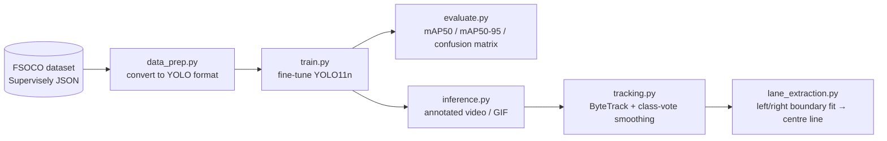

# FSOCO Cone Detection — real-time YOLO11n pipeline for Formula Student Driverless

End-to-end cone perception for a Formula Student Driverless car, built on the public
[FSOCO](https://fsoco.github.io/fsoco-dataset/) dataset: dataset conversion → fine-tuning a nano YOLO
model → evaluation → video inference → multi-object tracking → track centre-line estimation.

> 🇹🇷 Türkçe README için [README.md](README.md) dosyasına bakın.


| Detection | Tracking (persistent IDs + trails) |
|:--:|:--:|
|  |  |

> The GIFs/images above are generated by `make_readme_assets.py` after a real training run. At the
> time of writing, `docs/` only contains a `.gitkeep` placeholder.

## Architecture



## Features

- **`data_prep.py`** – converts FSOCO's Supervisely JSON to Ultralytics YOLO format; team-wise splits (no frame leakage), tag filtering, resizing, label-overlay previews, optional repeat-factor oversampling for rare classes.
- **`train.py`** – fine-tunes YOLO11n (or YOLOv8n) at 640×640 with cone-aware augmentation (no hue shift: blue ≠ yellow).
- **`evaluate.py`** – mAP50 / mAP50-95, per-class AP, confusion matrix, ground-truth-vs-prediction images.
- **`inference.py`** – annotated video / GIF from a video, a frame folder or a webcam.
- **`tracking.py`** – ByteTrack via `model.track()` plus class-vote smoothing and motion trails.
- **`lane_extraction.py`** – left/right boundary fits and centre line from blue/yellow cones (image space, or approximate top-down view).

## Code structure

| File / folder | Purpose |
|---|---|
| `common.py` | Class definitions, Unicode-safe I/O, drawing helpers, video/GIF sinks |
| `data_prep.py` | FSOCO (Supervisely JSON) → YOLO-format dataset conversion |
| `train.py` | Fine-tunes YOLO11n/YOLOv8n via `ultralytics.YOLO(...).train()` |
| `evaluate.py` | mAP / confusion matrix / PR curves via `ultralytics.YOLO(...).val()` |
| `inference.py` | Annotated video/GIF output via `ultralytics.YOLO(...).predict()` |
| `tracking.py` | ByteTrack + class-vote smoothing + trails (`configs/bytetrack_cones.yaml`) |
| `lane_extraction.py` | Left/right boundary fit + centre-line estimate |
| `make_readme_assets.py` | One-shot README figure/metrics generator |
| `check_gpu.py` | CUDA availability / suggested batch-size check |
| `import_roboflow.py` | Optional: import a dataset from Roboflow instead of raw FSOCO |
| `configs/bytetrack_cones.yaml` | ByteTrack tuning for small, slow-moving cone detections |
| `tools/make_synthetic_fsoco.py` | Generates synthetic FSOCO-format data for pipeline smoke tests |
| `tests/test_pipeline.py` | Unit tests (conversion + centre-line geometry) |
| `notebooks/colab_train.ipynb` | Free-GPU (Colab) training notebook |
| `data/`, `runs/`, `weights/` | **Git-ignored.** Raw/converted datasets, training runs, model checkpoints — see Installation |

## Results

> ⚠️ **Training status: incomplete, not a final benchmark.** The checked-in `runs/fsoco_mono_yolo11n/`
> run was configured for 100 epochs (`args.yaml`: `epochs: 100`), but only **2 epochs** had finished
> logging at the time this README was written (`results.csv` has 2 data rows). The table below reports
> those two real, logged epochs — it is an early-training snapshot, not a converged model.

| Epoch | Precision | Recall | mAP50 | mAP50-95 |
|---|---|---|---|---|
| 1 | 0.819 | 0.346 | 0.382 | 0.226 |
| 2 (last logged) | 0.826 | 0.378 | 0.417 | 0.246 |

*(Source: `runs/fsoco_mono_yolo11n/results.csv`.)*

`runs/detect/runs/smoke/` is a separate 2-epoch sanity run on **synthetic** cone images generated by
`tools/make_synthetic_fsoco.py`; consistent with this project's own rule ("metrics on synthetic data are
meaningless — never report them"), those numbers are intentionally excluded above.

<!-- METRICS_START -->
_Full-training metrics not generated yet._
<!-- METRICS_END -->

| Confusion matrix (normalised) | Sample predictions |
|:--:|:--:|
|  |  |

Class distribution after conversion (log scale):


### Centre-line extraction


Blue cones are the left boundary and yellow the right (Formula Student rules). Each side is fitted
through the cones' base points with a low-degree polynomial (or smoothing spline); the centre line is
the mean of both curves. With a focal length (`--fx`) the cone height gives depth (`Z = fx·H/h_px`),
which yields the approximate top-down inset. It is an **estimate** from a single uncalibrated camera, not a
metric ground truth.

## Installation & quick start

```bash
git clone https://github.com/<your-user>/fsoco-cone-detection.git
cd fsoco-cone-detection
python -m venv .venv && source .venv/bin/activate      # Windows: .venv\Scripts\activate
pip install -r requirements.txt
python check_gpu.py                                    # is CUDA visible? suggested batch size
```

On Windows with an NVIDIA GPU install the CUDA build of PyTorch first
(`pip install torch torchvision --index-url https://download.pytorch.org/whl/cu124`), then the rest. No GPU?
Use the [Colab notebook](notebooks/colab_train.ipynb) (free T4).

`requirements.txt` pulls in AGPL-3.0-licensed `ultralytics>=8.3.0` (see the **License** section below).

## Step 1 – Get FSOCO (manual)

FSOCO is publicly available; since August 2022 **no registration or data contribution is required**.

1. Open the official download page: <https://fsoco.github.io/fsoco-dataset/download>
2. Download **Bounding Boxes** (~24 GB, training set). The *Panoptic Segmentation* archive (4 GB) is not needed.
3. Extract it. You should get one folder per team, each with `img/` and `ann/` sub-folders:
   ```
   fsoco_bounding_boxes_train/
   ├── <team_a>/{img/*.jpg, ann/*.jpg.json}
   └── <team_b>/...
   ```
4. Mind the license: the dataset tooling is GPL-3.0 and the data is community-contributed; check the
   [dataset site](https://fsoco.github.io/fsoco-dataset/) and cite the paper if you publish results:
   *Vödisch et al., "FSOCO: The Formula Student Objects in Context Dataset", SAE Int. J. CAV 2022
   ([arXiv:2012.07139](https://arxiv.org/abs/2012.07139)).*

> ⚠️ `fsoco-dataset.com` is no longer the project site (it now serves unrelated content); the current
> link is `fsoco.github.io`. See the References table for the dataset's redistribution terms.

Annotation format: Supervisely JSON with classes `blue_cone`, `yellow_cone`, `orange_cone` (small),
`large_orange_cone`, `unknown_cone` ("other"), plus tags `truncated`, `knocked_over`, `sticker_band_removed`.
The official class list also contains `seg_*` classes used for the segmentation subset; they are ignored.

## Step 2 – Convert to YOLO format

```bash
# 400-image smoke subset first – verifies the whole pipeline in minutes
python data_prep.py --src /path/to/fsoco_bounding_boxes_train --out data/fsoco_small --subset 400

# full dataset, team-wise split, rare-class oversampling
python data_prep.py --src /path/to/fsoco_bounding_boxes_train --out data/fsoco_yolo --oversample --split-by team
```

Look at `data/fsoco_yolo/preview/*.jpg` – these are converted labels drawn on the images. If boxes look
shifted by a constant border, re-run with `--remove-watermark`.

Notable options: `--exclude-tags knocked_over truncated`, `--max-side 1280` (resize for faster loading),
`--link symlink|hardlink|copy`, `--val-frac/--test-frac`.

**Why split by team?** FSOCO frames come from video sequences; neighbouring frames are near-duplicates, so a
random image split leaks test data into training and inflates mAP. Splitting by team (`--split-by team`) measures
generalisation to unseen cars/tracks.

## Step 3 – Train

```bash
python train.py --data data/fsoco_small/data.yaml --epochs 3 --batch 8 --name smoke        # sanity check
python train.py --data data/fsoco_yolo/data.yaml  --epochs 100 --batch 16 --name fsoco_yolo11n
python train.py --data data/fsoco_yolo/data.yaml  --model yolov8n.pt --name fsoco_yolov8n  # alternative
```

| Setting | Value | Rationale |
|---|---|---|
| Input | 640×640 | real-time budget, cones are small → don't go lower |
| Weights | COCO-pretrained YOLO11n | fast convergence |
| Optimiser | SGD, lr0 0.01, cosine decay | explicit, because `optimizer=auto` ignores `lr0` |
| Hue augmentation | **0** | a hue shift would turn blue cones yellow |
| Saturation / value | 0.6 / 0.4 | sun, shade, wet asphalt |
| Mosaic / scale / translate | 1.0 / 0.5 / 0.1 | many small objects, varying distance |
| Class imbalance | repeat-factor sampling (`--oversample`) + `--cls` gain | Ultralytics has no per-class loss weights |

Weights end up in `runs/<name>/weights/best.pt` — this directory is git-ignored (see below), so it stays
local/your-CI-artifact-storage, not in the repository.

## Step 4 – Evaluate

```bash
python evaluate.py --weights runs/fsoco_yolo11n/weights/best.pt --data data/fsoco_yolo/data.yaml --split test
```

Writes `results/metrics.{json,md}`, the confusion matrix, PR/F1 curves and `predictions/gt_vs_pred_*.jpg`.

## Step 5 – Inference, tracking, centre line

```bash
python inference.py --weights best.pt --source drive.mp4 --out outputs/detect.mp4 --gif docs/demo_detection.gif
python tracking.py  --weights best.pt --source drive.mp4 --out outputs/track.mp4  --gif docs/demo_tracking.gif
python tracking.py  --weights best.pt --source drive.mp4 --lane --fx 900            # + centre-line overlay
python lane_extraction.py --weights best.pt --image frame.jpg --out docs/lane_extraction.jpg [--fx 900]
```

`--source` accepts a video, an image, a folder of frames, or a webcam index. If `ffmpeg` is installed the MP4 is
re-encoded to H.264 so it plays everywhere.

### Generate all README assets at once

```bash
python make_readme_assets.py --weights runs/fsoco_yolo11n/weights/best.pt \
    --data data/fsoco_yolo/data.yaml --video my_drive.mp4
```

This fills the results table above and writes the GIFs/figures into `docs/`.

## Testing the pipeline without the 24 GB download

`tools/make_synthetic_fsoco.py` renders cartoon cones in FSOCO's exact folder/JSON layout (and a driving video),
which is how the code in this repo was smoke-tested:

```bash
python tools/make_synthetic_fsoco.py --out data/synthetic --images 300 --video data/synthetic_demo.mp4
python data_prep.py --src data/synthetic --out data/synthetic_yolo
pytest -q                      # unit tests: conversion + centre-line geometry
```

Metrics on synthetic data are meaningless – never report them.

## What's git-ignored, and why

This repo trains on a ~24 GB public dataset and produces training-run checkpoints — none of that belongs
in git history. `.gitignore` excludes:

- `data/` — the raw/converted FSOCO dataset (tens of thousands of images; many GB)
- `runs/` — Ultralytics training-run outputs (logs, curves, checkpoints per run)
- `weights/*.pt` and `*.pt` generally — model checkpoints, including the bundled `yolo11n.pt` base
  weights and anything saved under `weights/`
- `outputs/`, `*.raw.mp4` — generated videos
- `.venv/`, `venv/`, `__pycache__/`, `*.pyc`, `.pytest_cache/` — local environment / build artefacts
- `docs/` is explicitly **kept** (`!docs/`) so the small demo GIFs/figures used by this README can be
  committed once generated — do not drop full datasets or checkpoints in there.

## Project layout

```
common.py              class definitions, Unicode-safe I/O, drawing, video/GIF sinks
data_prep.py           FSOCO (Supervisely) -> YOLO
train.py  evaluate.py  training / metrics
inference.py           annotated video
tracking.py            ByteTrack + class voting + trails  (configs/bytetrack_cones.yaml)
lane_extraction.py     boundary fits + centre line
make_readme_assets.py  one-shot README figures
check_gpu.py           CUDA / batch-size check
notebooks/colab_train.ipynb
tools/make_synthetic_fsoco.py
tests/test_pipeline.py
```

## Limitations / next steps

- Training on real FSOCO data is not yet complete (see Results) — numbers here are a work in progress.
- Boxes on truncated or knocked-over cones are noisy labels; try `--exclude-tags`.
- Centre line is fit per frame without temporal smoothing; top-down mode assumes a level camera and a known focal length.
- Possible extensions: ONNX/TensorRT export, stereo or LiDAR fusion, temporal filtering of the centre line.

## References

| Resource | Link | Notes |
|---|---|---|
| FSOCO dataset | <https://fsoco.github.io/fsoco-dataset/> (download: <https://fsoco.github.io/fsoco-dataset/download>) | Public since Aug 2022, no registration needed; described as open "for all Formula Student / FSAE teams." Its terms page does not state a standard open-data license (e.g. CC-BY/CC0) — redistribution of the data itself, or showcasing data samples in a public portfolio, is not explicitly addressed. Note: the domain `fsoco-dataset.com` (sometimes cited) no longer hosts the project — the current link is `fsoco.github.io`. Cite: Vödisch et al., "FSOCO: The Formula Student Objects in Context Dataset," SAE Int. J. CAV, 2022 ([arXiv:2012.07139](https://arxiv.org/abs/2012.07139)). |
| Ultralytics YOLO11 | <https://github.com/ultralytics/ultralytics> | **AGPL-3.0.** This is the code actually imported and run by `train.py`/`evaluate.py`/`inference.py`/`tracking.py`/`lane_extraction.py`. See License below. |
| ByteTrack | used via `model.track()`, tuned in `configs/bytetrack_cones.yaml` | Zhang et al., "ByteTrack: Multi-Object Tracking by Associating Every Detection Box," ECCV 2022. |

## License

This project uses Ultralytics' AGPL-3.0-licensed YOLO11 library (`ultralytics>=8.3.0`) — `train.py`,
`evaluate.py`, `inference.py`, `tracking.py` and `lane_extraction.py` all do
`from ultralytics import YOLO` — and is therefore licensed under **AGPL-3.0**; see `LICENSE`.

**Dataset:** FSOCO's own terms are separate from the code's license — see the References table above
and <https://fsoco.github.io/fsoco-dataset/download>.
