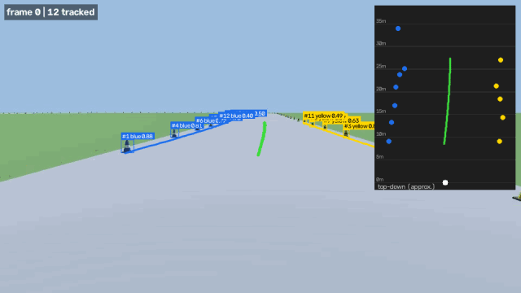
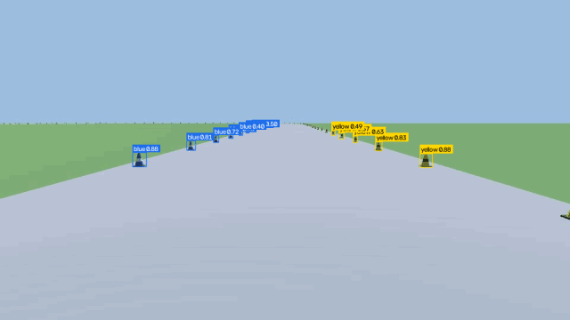
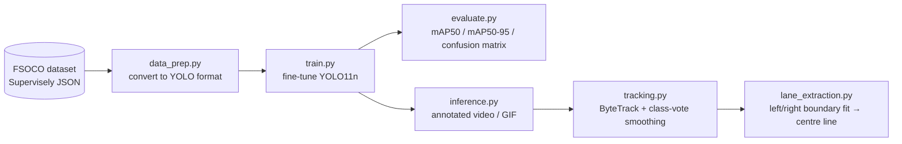
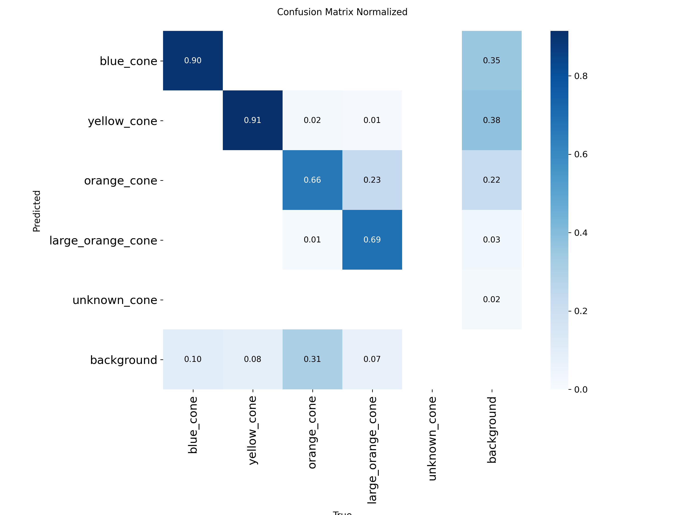
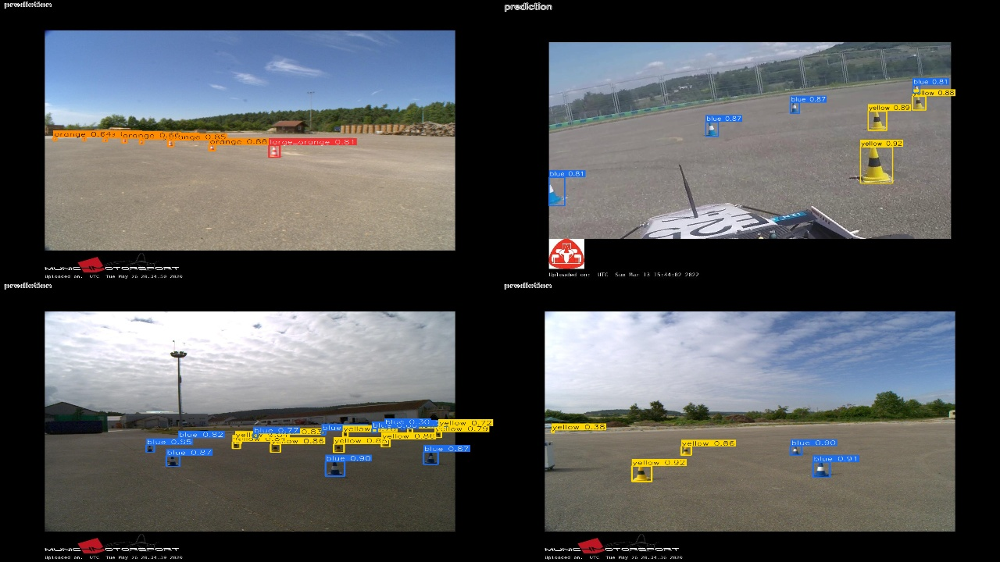
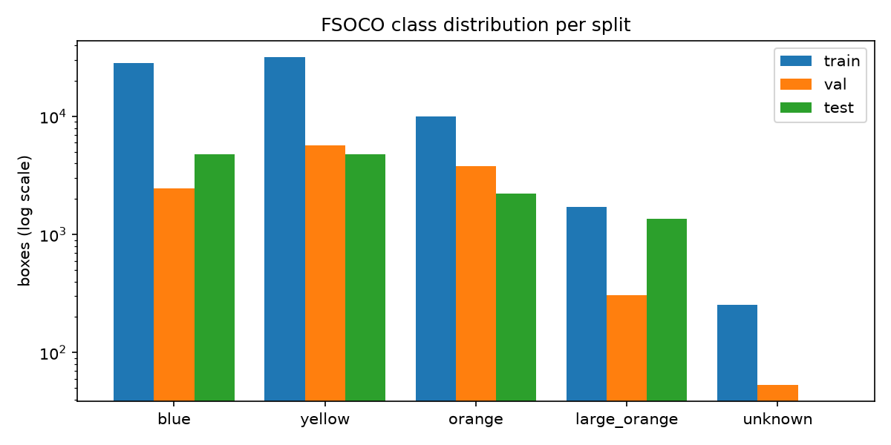
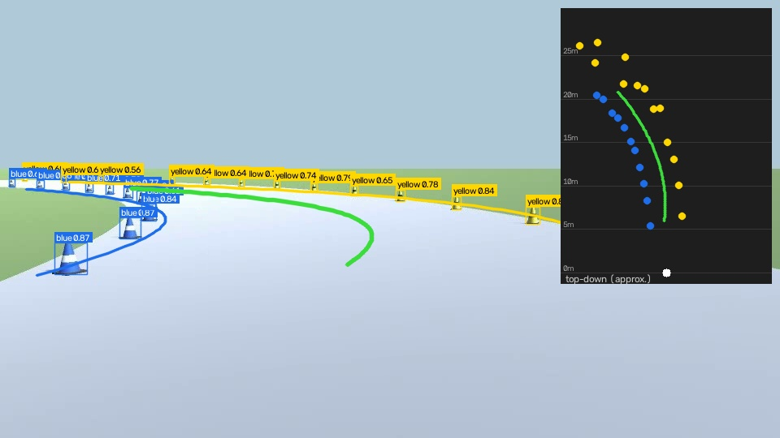

# FSOCO Cone Detection — real-time YOLO11n pipeline for Formula Student Driverless

End-to-end cone perception for a Formula Student Driverless car, built on the public
[FSOCO](https://fsoco.github.io/fsoco-dataset/) dataset: dataset conversion → fine-tuning a nano YOLO
model → evaluation → video inference → multi-object tracking → track centre-line estimation.

> 🇹🇷 Türkçe README için [README.md](README.md) dosyasına bakın.



| Detection | Tracking (persistent IDs + trails) |
|:--:|:--:|
|  |  |

> **The demo clips are a Unity simulation, not real footage.** They are raw front-camera frames (960×540, 10 Hz) from a separate
> Unity cone-track simulation (my [perception_control_loop](https://github.com/NightKnight-nx2/perception-control-loop) project). The detector was trained **only on real FSOCO photos**
> and was never fine-tuned on simulated images, so these clips also show how it transfers to a synthetic domain
> (it detects most cones, but nearby cones are sometimes missed and far cones are noisy).

## Architecture



## Features

- **`import_roboflow.py`** – imports a Roboflow YOLOv8 export (class remapping, team-wise re-split).
- **`data_prep.py`** – converts FSOCO's Supervisely JSON to Ultralytics YOLO format; team-wise splits (no frame leakage), tag filtering, resizing, label-overlay previews, optional repeat-factor oversampling for rare classes.
- **`train.py`** – fine-tunes YOLO11n (or YOLOv8n) at 640×640 with cone-aware augmentation (no hue shift: blue ≠ yellow).
- **`evaluate.py`** – mAP50 / mAP50-95, per-class AP, confusion matrix, ground-truth-vs-prediction images.
- **`inference.py`** – annotated video / GIF from a video, a frame folder or a webcam.
- **`tracking.py`** – ByteTrack via `model.track()` plus class-vote smoothing and motion trails.
- **`lane_extraction.py`** – left/right boundary fits and centre line from blue/yellow cones (image space, or approximate top-down view).

## Code structure

| File / folder | Purpose |
|---|---|
| `common.py` | Class definitions, Unicode-safe I/O, drawing helpers, video/GIF sinks |
| `data_prep.py` | FSOCO (Supervisely JSON) → YOLO-format dataset conversion |
| `train.py` | Fine-tunes YOLO11n/YOLOv8n via `ultralytics.YOLO(...).train()` |
| `evaluate.py` | mAP / confusion matrix / PR curves via `ultralytics.YOLO(...).val()` |
| `inference.py` | Annotated video/GIF output via `ultralytics.YOLO(...).predict()` |
| `tracking.py` | ByteTrack + class-vote smoothing + trails (`configs/bytetrack_cones.yaml`) |
| `lane_extraction.py` | Left/right boundary fit + centre-line estimate |
| `make_readme_assets.py` | One-shot README figure/metrics generator |
| `check_gpu.py` | CUDA availability / suggested batch-size check |
| `import_roboflow.py` | Optional: import a dataset from Roboflow instead of raw FSOCO |
| `configs/bytetrack_cones.yaml` | ByteTrack tuning for small, slow-moving cone detections |
| `tools/make_synthetic_fsoco.py` | Generates synthetic FSOCO-format data for pipeline smoke tests |
| `tests/test_pipeline.py` | Unit tests (conversion + centre-line geometry) |
| `notebooks/colab_train.ipynb` | Free-GPU (Colab) training notebook |
| `data/`, `runs/`, `weights/` | **Git-ignored.** Raw/converted datasets, training runs, model checkpoints — see Installation |

## Results

<!-- METRICS_START -->
YOLO11n, 100 epochs, 640 px, trained on the `fsoco_mono` subset (see [Dataset used](#dataset-used-for-the-reported-results)).
**Held-out test split** (1,065 images from teams never seen in training): **mAP50 0.787, mAP50-95 0.491**, averaged over 4 classes.
Inference on an RTX 4050 Laptop GPU: 4.8 ms model + 1.8 ms pre-process + 1.5 ms post-process per image (batch 16).

| Class | Precision | Recall | AP50 | AP50-95 |
|---|---:|---:|---:|---:|
| blue_cone | 0.882 | 0.841 | 0.875 | 0.516 |
| yellow_cone | 0.879 | 0.877 | 0.893 | 0.538 |
| orange_cone | 0.657 | 0.600 | 0.603 | 0.358 |
| large_orange_cone | 0.968 | 0.659 | 0.776 | 0.553 |
| **all (4 classes)** | **0.846** | **0.744** | **0.787** | **0.491** |

Caveats, stated plainly:

- **`unknown_cone` is not evaluated on the test split** - none of the held-out teams has any (254 training boxes, 53 validation boxes in total). On the validation split its AP50 is 0.015, i.e. the model effectively does not detect it. Treat the detector as a 4-class cone detector.
- Scores depend strongly on which teams are held out: the validation split (788 images, 5 classes incl. `unknown_cone`) gives mAP50 0.544 / mAP50-95 0.331. The checkpoint was selected on validation; the test split was used once.
- Weak spots (see the confusion matrix): about 31 % of small orange cones are missed (tiny, far-away rows) and about 23 % of large orange cones are labelled small orange.
<!-- METRICS_END -->

| Confusion matrix (normalised) | Sample predictions |
|:--:|:--:|
|  |  |

Class distribution after conversion (log scale):



### Centre-line extraction



Blue cones are the left boundary and yellow the right (Formula Student rules). Each side is fitted
through the cones' base points with a low-degree polynomial (or smoothing spline); the centre line is
the mean of both curves. With a focal length (`--fx`) the cone height gives depth (`Z = fx·H/h_px`),
which yields the approximate top-down inset. It is an **estimate** from a single uncalibrated camera, not a
metric ground truth.

(Single frame from the Unity clip, `--fx 652` = focal length for the sim camera's 45° vertical FOV at 540 px height; the Unity cone size is assumed to be the 325 mm FSG cone, so metric distances in the top-down inset are approximate. The yellow/blue curves in the image view are polynomial fits and can bend at the image border; the top-down view is the more reliable of the two.)

## Installation & quick start

```bash
git clone https://github.com/NightKnight-nx2/fsoco-cone-detection.git
cd fsoco-cone-detection
python -m venv .venv && source .venv/bin/activate      # Windows: .venv\Scripts\activate
pip install -r requirements.txt
python check_gpu.py                                    # is CUDA visible? suggested batch size
```

On Windows with an NVIDIA GPU install the CUDA build of PyTorch first
(`pip uninstall -y torch torchvision` then `pip install torch torchvision --index-url https://download.pytorch.org/whl/cu128`; pick the CUDA tag from <https://pytorch.org/get-started/locally/>), then the rest. No GPU?
Use the [Colab notebook](notebooks/colab_train.ipynb) (free T4).

`requirements.txt` pulls in AGPL-3.0-licensed `ultralytics>=8.3.0` (see the **License** section below).

## Dataset used for the reported results

The numbers above were produced with the community Roboflow export
[`cvcs2025/fsoco_mono`](https://universe.roboflow.com/cvcs2025/fsoco_mono) (MIT, 5,930 images, 14 teams, 5 classes), not with the full 24 GB FSOCO release.
Filenames carry FSOCO team prefixes, so it appears to be derived from FSOCO, but the Roboflow page does not say so; credit FSOCO as well.
Images are already resized to 640 px with black padding, and some carry the original FSOCO team watermark.

```bash
# Roboflow "YOLOv8" export, unzipped into data/
python import_roboflow.py --src data/fsoco_mono.v1i.yolov8 --out data/fsoco_mono_yolo --oversample
python train.py --data data/fsoco_mono_yolo/data.yaml --epochs 100 --batch 16 --cache ram --name fsoco_mono_yolo11n
python evaluate.py --weights runs/fsoco_mono_yolo11n/weights/best.pt --data data/fsoco_mono_yolo/data.yaml --split test
```

`import_roboflow.py` remaps Roboflow's alphabetical class order to this repo's order and re-splits **by team** (the original export split frames randomly, which leaks near-duplicate frames).

| Boxes | train | val | test |
|---|---:|---:|---:|
| images | 4,077 | 788 | 1,065 |
| blue_cone | 28,180 | 2,478 | 4,823 |
| yellow_cone | 32,036 | 5,660 | 4,787 |
| orange_cone | 10,079 | 3,807 | 2,226 |
| large_orange_cone | 1,713 | 306 | 1,362 |
| unknown_cone | 254 | 53 | 0 |

## Step 1 – Get FSOCO (manual)

FSOCO is publicly available; since August 2022 **no registration or data contribution is required**.

1. Open the official download page: <https://fsoco.github.io/fsoco-dataset/download>
2. Download **Bounding Boxes** (~24 GB, training set). The *Panoptic Segmentation* archive (4 GB) is not needed.
3. Extract it. You should get one folder per team, each with `img/` and `ann/` sub-folders:
   ```
   fsoco_bounding_boxes_train/
   ├── <team_a>/{img/*.jpg, ann/*.jpg.json}
   └── <team_b>/...
   ```
4. Mind the license: the dataset tooling is GPL-3.0 and the data is community-contributed; check the
   [dataset site](https://fsoco.github.io/fsoco-dataset/) and cite the paper if you publish results:
   *Vödisch et al., "FSOCO: The Formula Student Objects in Context Dataset", SAE Int. J. CAV 2022
   ([arXiv:2012.07139](https://arxiv.org/abs/2012.07139)).*

> ⚠️ `fsoco-dataset.com` is no longer the project site (it now serves unrelated content); the current
> link is `fsoco.github.io`. See the References table for the dataset's redistribution terms.

Annotation format: Supervisely JSON with classes `blue_cone`, `yellow_cone`, `orange_cone` (small),
`large_orange_cone`, `unknown_cone` ("other"), plus tags `truncated`, `knocked_over`, `sticker_band_removed`.
The official class list also contains `seg_*` classes used for the segmentation subset; they are ignored.

## Step 2 – Convert to YOLO format

```bash
# 400-image smoke subset first – verifies the whole pipeline in minutes
python data_prep.py --src /path/to/fsoco_bounding_boxes_train --out data/fsoco_small --subset 400

# full dataset, team-wise split, rare-class oversampling
python data_prep.py --src /path/to/fsoco_bounding_boxes_train --out data/fsoco_yolo --oversample --split-by team
```

Look at `data/fsoco_yolo/preview/*.jpg` – these are converted labels drawn on the images. If boxes look
shifted by a constant border, re-run with `--remove-watermark`.

Notable options: `--exclude-tags knocked_over truncated`, `--max-side 1280` (resize for faster loading),
`--link symlink|hardlink|copy`, `--val-frac/--test-frac`.

**Why split by team?** FSOCO frames come from video sequences; neighbouring frames are near-duplicates, so a
random image split leaks test data into training and inflates mAP. Splitting by team (`--split-by team`) measures
generalisation to unseen cars/tracks.

## Step 3 – Train

```bash
python train.py --data data/fsoco_small/data.yaml --epochs 3 --batch 8 --name smoke        # sanity check
python train.py --data data/fsoco_yolo/data.yaml  --epochs 100 --batch 16 --name fsoco_yolo11n
python train.py --data data/fsoco_yolo/data.yaml  --model yolov8n.pt --name fsoco_yolov8n  # alternative
```

| Setting | Value | Rationale |
|---|---|---|
| Input | 640×640 | real-time budget, cones are small → don't go lower |
| Weights | COCO-pretrained YOLO11n | fast convergence |
| Optimiser | SGD, lr0 0.01, cosine decay | explicit, because `optimizer=auto` ignores `lr0` |
| Hue augmentation | **0** | a hue shift would turn blue cones yellow |
| Saturation / value | 0.6 / 0.4 | sun, shade, wet asphalt |
| Mosaic / scale / translate | 1.0 / 0.5 / 0.1 | many small objects, varying distance |
| Class imbalance | repeat-factor sampling (`--oversample`) + `--cls` gain | Ultralytics has no per-class loss weights |

Weights end up in `runs/<name>/weights/best.pt` — this directory is git-ignored (see below), so it stays
local/your-CI-artifact-storage, not in the repository.

## Step 4 – Evaluate

```bash
python evaluate.py --weights runs/fsoco_yolo11n/weights/best.pt --data data/fsoco_yolo/data.yaml --split test
```

Writes `results/metrics.{json,md}`, the confusion matrix, PR/F1 curves and `predictions/gt_vs_pred_*.jpg`.

## Step 5 – Inference, tracking, centre line

```bash
python inference.py --weights best.pt --source drive.mp4 --out outputs/detect.mp4 --gif docs/demo_detection.gif
python tracking.py  --weights best.pt --source drive.mp4 --out outputs/track.mp4  --gif docs/demo_tracking.gif
python tracking.py  --weights best.pt --source drive.mp4 --lane --fx 900            # + centre-line overlay
python lane_extraction.py --weights best.pt --image frame.jpg --out docs/lane_extraction.jpg [--fx 900]
```

`--source` accepts a video, an image, a folder of frames, or a webcam index. If `ffmpeg` is installed the MP4 is
re-encoded to H.264 so it plays everywhere.

### Generate all README assets at once

```bash
python make_readme_assets.py --weights runs/fsoco_yolo11n/weights/best.pt \
    --data data/fsoco_yolo/data.yaml --video my_drive.mp4
```

This fills the results table above and writes the GIFs/figures into `docs/`.

## Testing the pipeline without the 24 GB download

`tools/make_synthetic_fsoco.py` renders cartoon cones in FSOCO's exact folder/JSON layout (and a driving video),
which is how the code in this repo was smoke-tested:

```bash
python tools/make_synthetic_fsoco.py --out data/synthetic --images 300 --video data/synthetic_demo.mp4
python data_prep.py --src data/synthetic --out data/synthetic_yolo
pytest -q                      # unit tests: conversion + centre-line geometry
```

Metrics on synthetic data are meaningless – never report them.

## What's git-ignored, and why

This repo trains on a ~24 GB public dataset and produces training-run checkpoints — none of that belongs
in git history. `.gitignore` excludes:

- `data/` — the raw/converted FSOCO dataset (tens of thousands of images; many GB)
- `runs/` — Ultralytics training-run outputs (logs, curves, checkpoints per run)
- `weights/*.pt` and `*.pt` generally — model checkpoints, including the bundled `yolo11n.pt` base
  weights and anything saved under `weights/`
- `outputs/`, `*.raw.mp4` — generated videos
- `.venv/`, `venv/`, `__pycache__/`, `*.pyc`, `.pytest_cache/` — local environment / build artefacts
- `docs/` is explicitly **kept** (`!docs/`) so the small demo GIFs/figures used by this README can be
  committed once generated — do not drop full datasets or checkpoints in there.

## Project layout

```
common.py              class definitions, Unicode-safe I/O, drawing, video/GIF sinks
data_prep.py           FSOCO (Supervisely) -> YOLO
train.py  evaluate.py  training / metrics
inference.py           annotated video
tracking.py            ByteTrack + class voting + trails  (configs/bytetrack_cones.yaml)
lane_extraction.py     boundary fits + centre line
make_readme_assets.py  one-shot README figures
check_gpu.py           CUDA / batch-size check
notebooks/colab_train.ipynb
tools/make_synthetic_fsoco.py
tests/test_pipeline.py
```

## Limitations / next steps

- **Tracking is the weakest part.** ByteTrack associates boxes by IoU; cones are tiny, so at the 10 Hz of the Unity clip the boxes barely overlap
  between frames and tracks fragment: over the 300-frame demo the tracker produced 137 track IDs with a mean length of 43 frames
  (62 tracks lasted >= 30 frames); with the stock ByteTrack settings it was 190 IDs / mean 19 frames. A higher frame rate or a motion-compensated tracker would help (BoT-SORT with camera-motion compensation was *worse* here: 168 IDs, mean 3.5 frames in a 120-frame test).
- The detector does not recognise `unknown_cone` and was not evaluated on it (see Results).
- Boxes on truncated or knocked-over cones are noisy labels; try `--exclude-tags`.
- Centre line is fit per frame without temporal smoothing; top-down mode assumes a level camera and a known focal length.
- Possible extensions: ONNX/TensorRT export, stereo or LiDAR fusion, temporal filtering of the centre line.

## References

| Resource | Link | Notes |
|---|---|---|
| FSOCO dataset | <https://fsoco.github.io/fsoco-dataset/> (download: <https://fsoco.github.io/fsoco-dataset/download>) | Public since Aug 2022, no registration needed; described as open "for all Formula Student / FSAE teams." Its terms page does not state a standard open-data license (e.g. CC-BY/CC0) — redistribution of the data itself, or showcasing data samples in a public portfolio, is not explicitly addressed. Note: the domain `fsoco-dataset.com` (sometimes cited) no longer hosts the project — the current link is `fsoco.github.io`. Cite: Vödisch et al., "FSOCO: The Formula Student Objects in Context Dataset," SAE Int. J. CAV, 2022 ([arXiv:2012.07139](https://arxiv.org/abs/2012.07139)). |
| Ultralytics YOLO11 | <https://github.com/ultralytics/ultralytics> | **AGPL-3.0.** This is the code actually imported and run by `train.py`/`evaluate.py`/`inference.py`/`tracking.py`/`lane_extraction.py`. See License below. |
| ByteTrack | used via `model.track()`, tuned in `configs/bytetrack_cones.yaml` | Zhang et al., "ByteTrack: Multi-Object Tracking by Associating Every Detection Box," ECCV 2022. |

## License

This project uses Ultralytics' AGPL-3.0-licensed YOLO11 library (`ultralytics>=8.3.0`) — `train.py`,
`evaluate.py`, `inference.py`, `tracking.py` and `lane_extraction.py` all do
`from ultralytics import YOLO` — and is therefore licensed under **AGPL-3.0**; see `LICENSE`.

**Dataset:** FSOCO's own terms are separate from the code's license — see the References table above
and <https://fsoco.github.io/fsoco-dataset/download>.
