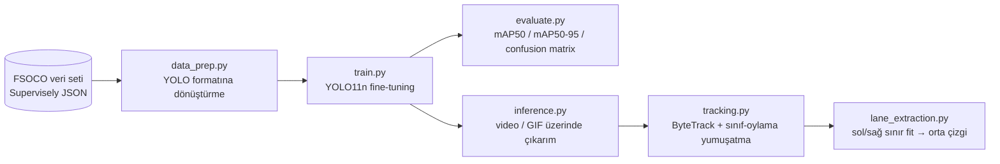

# FSOCO Koni Algılama — Formula Student Driverless için gerçek-zamanlı YOLO11n pipeline'ı

Formula Student Driverless aracı için uçtan uca koni algılama: herkese açık
[FSOCO](https://fsoco.github.io/fsoco-dataset/) veri setini dönüştürme → küçük bir YOLO modelini
fine-tune etme → değerlendirme → video üzerinde çıkarım → çok-nesne takibi → pist orta çizgisi tahmini.

> 🇬🇧 English README: [README.en.md](README.en.md)


| Algılama | Takip (kalıcı ID + iz) |
|:--:|:--:|
|  |  |

> Yukarıdaki GIF/görseller `make_readme_assets.py` ile gerçek bir eğitim koşusu sonrasında üretilir.
> Bu README yazıldığı anda `docs/` klasöründe sadece bir `.gitkeep` yer tutucusu bulunuyor.

## Mimari



## Özellikler

- **`data_prep.py`** – FSOCO'nun Supervisely JSON formatını Ultralytics YOLO formatına çevirir; takım
  bazlı split (kare sızıntısı yok), tag filtreleme, yeniden boyutlandırma, etiket-üstü önizlemeler,
  nadir sınıflar için opsiyonel tekrar-faktörü (oversampling).
- **`train.py`** – YOLO11n'i (veya YOLOv8n'i) 640×640'ta koni-bilinçli augmentation ile fine-tune eder
  (hue kaydırma yok: mavi ≠ sarı).
- **`evaluate.py`** – mAP50 / mAP50-95, sınıf başına AP, confusion matrix, gerçek-vs-tahmin görselleri.
- **`inference.py`** – video, kare klasörü veya webcam'den anotasyonlu video/GIF üretir.
- **`tracking.py`** – `model.track()` üzerinden ByteTrack, sınıf-oylama yumuşatma ve hareket izleri.
- **`lane_extraction.py`** – mavi/sarı konilerden sol/sağ sınır fit'i ve orta çizgi (görüntü uzayında
  veya yaklaşık kuşbakışı görünümde).

## Kod yapısı

| Dosya / klasör | Amaç |
|---|---|
| `common.py` | Sınıf tanımları, Unicode-güvenli I/O, çizim yardımcıları, video/GIF çıkışları |
| `data_prep.py` | FSOCO (Supervisely JSON) → YOLO formatına dönüştürme |
| `train.py` | `ultralytics.YOLO(...).train()` ile YOLO11n/YOLOv8n fine-tuning |
| `evaluate.py` | `ultralytics.YOLO(...).val()` ile mAP / confusion matrix / PR eğrileri |
| `inference.py` | `ultralytics.YOLO(...).predict()` ile anotasyonlu video/GIF |
| `tracking.py` | ByteTrack + sınıf-oylama + izler (`configs/bytetrack_cones.yaml`) |
| `lane_extraction.py` | Sol/sağ sınır fit'i + orta çizgi tahmini |
| `make_readme_assets.py` | README görselleri/metriklerini tek seferde üreten betik |
| `check_gpu.py` | CUDA uygunluğu / önerilen batch-size kontrolü |
| `import_roboflow.py` | Opsiyonel: ham FSOCO yerine Roboflow'dan veri seti içe alma |
| `configs/bytetrack_cones.yaml` | Küçük, yavaş hareket eden koni algılamaları için ByteTrack ayarı |
| `tools/make_synthetic_fsoco.py` | Pipeline duman testleri için sentetik FSOCO-formatlı veri üretir |
| `tests/test_pipeline.py` | Birim testleri (dönüştürme + orta çizgi geometrisi) |
| `notebooks/colab_train.ipynb` | Ücretsiz GPU (Colab) eğitim notebook'u |
| `data/`, `runs/`, `weights/` | **Git tarafından yok sayılır.** Ham/dönüştürülmüş veri setleri, eğitim koşuları, model ağırlıkları — bkz. Kurulum |

## Sonuçlar

> ⚠️ **Eğitim durumu: tamamlanmadı, nihai bir benchmark değil.** Depoda bulunan
> `runs/fsoco_mono_yolo11n/` koşusu 100 epoch için ayarlanmıştı (`args.yaml`: `epochs: 100`), ama bu
> README yazıldığı anda sadece **2 epoch** loglanmıştı (`results.csv`'de 2 veri satırı var). Aşağıdaki
> tablo bu iki gerçek, loglanmış epoch'u gösteriyor — bu erken-eğitim anlık görüntüsüdür, yakınsamış bir
> model DEĞİLDİR.

| Epoch | Precision | Recall | mAP50 | mAP50-95 |
|---|---|---|---|---|
| 1 | 0.819 | 0.346 | 0.382 | 0.226 |
| 2 (son loglanan) | 0.826 | 0.378 | 0.417 | 0.246 |

*(Kaynak: `runs/fsoco_mono_yolo11n/results.csv`.)*

`runs/detect/runs/smoke/`, `tools/make_synthetic_fsoco.py` ile üretilen **sentetik** koni görselleri
üzerinde ayrı, 2 epoch'luk bir duman testidir; bu projenin kendi kuralıyla uyumlu olarak ("sentetik veri
üzerindeki metrikler anlamsızdır – asla raporlamayın") bu sayılar yukarıda kasıtlı olarak hariç
tutulmuştur.

<!-- METRICS_START -->
_Tam eğitim metrikleri henüz üretilmedi._
<!-- METRICS_END -->

| Confusion matrix (normalize) | Örnek tahminler |
|:--:|:--:|
|  |  |

Dönüştürme sonrası sınıf dağılımı (log ölçek):


### Orta çizgi çıkarımı


Mavi koniler sol sınır, sarı koniler sağ sınırdır (Formula Student kurallarına göre). Her taraf,
konilerin taban noktalarından düşük dereceli bir polinom (veya smoothing spline) ile fit edilir; orta
çizgi iki eğrinin ortalamasıdır. Bir odak uzaklığı (`--fx`) verildiğinde koni yüksekliği derinlik verir
(`Z = fx·H/h_px`), bu da yaklaşık kuşbakışı görünümü sağlar. Bu, kalibre edilmemiş tek bir kameradan
**tahmindir**, metrik bir zemin gerçeği değildir.

## Kurulum ve hızlı başlangıç

```bash
git clone https://github.com/<kullanici-adiniz>/fsoco-cone-detection.git
cd fsoco-cone-detection
python -m venv .venv && source .venv/bin/activate      # Windows: .venv\Scripts\activate
pip install -r requirements.txt
python check_gpu.py                                    # CUDA görünüyor mu? önerilen batch size
```

Windows'ta NVIDIA GPU varsa önce PyTorch'un CUDA sürümünü kurun
(`pip install torch torchvision --index-url https://download.pytorch.org/whl/cu124`), sonra kalanını.
GPU yoksa [Colab notebook](notebooks/colab_train.ipynb)'u (ücretsiz T4) kullanın.

`requirements.txt`, AGPL-3.0 lisanslı `ultralytics>=8.3.0`'ı çeker (bkz. **Lisans** bölümü).

## Adım 1 – FSOCO'yu edinme (manuel)

FSOCO herkese açıktır; Ağustos 2022'den beri **kayıt veya veri katkısı gerekmiyor**.

1. Resmi indirme sayfasını açın: <https://fsoco.github.io/fsoco-dataset/download>
2. **Bounding Boxes** arşivini indirin (~24 GB, eğitim seti). *Panoptic Segmentation* arşivi (4 GB)
   gerekli değil.
3. Arşivi açın. Her biri `img/` ve `ann/` alt klasörlerine sahip, takım başına bir klasör almalısınız:
   ```
   fsoco_bounding_boxes_train/
   ├── <takim_a>/{img/*.jpg, ann/*.jpg.json}
   └── <takim_b>/...
   ```
4. Lisansa dikkat edin: veri seti araçları GPL-3.0'dır ve veri topluluk katkılıdır; sonuç
   yayınlayacaksanız [veri seti sitesini](https://fsoco.github.io/fsoco-dataset/) kontrol edin ve
   makaleyi referans gösterin: *Vödisch ve ark., "FSOCO: The Formula Student Objects in Context
   Dataset", SAE Int. J. CAV 2022 ([arXiv:2012.07139](https://arxiv.org/abs/2012.07139)).*

> ⚠️ `fsoco-dataset.com` artık proje sitesi değil (artık ilgisiz içerik sunuyor); güncel link
> `fsoco.github.io`'dur. Veri setinin yeniden dağıtım şartları için Kaynakça tablosuna bakın.

Etiket formatı: `blue_cone`, `yellow_cone`, `orange_cone` (küçük), `large_orange_cone`, `unknown_cone`
("diğer") sınıflarına sahip Supervisely JSON, ayrıca `truncated`, `knocked_over`,
`sticker_band_removed` tag'leri. Resmi sınıf listesinde segmentasyon alt kümesi için kullanılan `seg_*`
sınıfları da var; bunlar yok sayılır.

## Adım 2 – YOLO formatına dönüştürme

```bash
# önce 400 görsellik duman testi alt kümesi – tüm pipeline'ı dakikalar içinde doğrular
python data_prep.py --src /path/to/fsoco_bounding_boxes_train --out data/fsoco_small --subset 400

# tam veri seti, takım bazlı split, nadir sınıf oversampling
python data_prep.py --src /path/to/fsoco_bounding_boxes_train --out data/fsoco_yolo --oversample --split-by team
```

`data/fsoco_yolo/preview/*.jpg`'e bakın – bunlar görseller üzerine çizilmiş dönüştürülmüş etiketlerdir.
Kutular sabit bir kenar boşluğuyla kaymış görünüyorsa `--remove-watermark` ile yeniden çalıştırın.

Dikkat çekici seçenekler: `--exclude-tags knocked_over truncated`, `--max-side 1280` (daha hızlı yükleme
için yeniden boyutlandırma), `--link symlink|hardlink|copy`, `--val-frac/--test-frac`.

**Neden takım bazlı split?** FSOCO kareleri video dizilerinden gelir; bitişik kareler neredeyse
birbirinin aynısıdır, bu yüzden rastgele görsel split'i test verisini eğitime sızdırır ve mAP'i
şişirir. Takım bazlı split (`--split-by team`) görülmemiş araçlara/pistlere genelleme ölçer.

## Adım 3 – Eğitim

```bash
python train.py --data data/fsoco_small/data.yaml --epochs 3 --batch 8 --name smoke        # sağlık kontrolü
python train.py --data data/fsoco_yolo/data.yaml  --epochs 100 --batch 16 --name fsoco_yolo11n
python train.py --data data/fsoco_yolo/data.yaml  --model yolov8n.pt --name fsoco_yolov8n  # alternatif
```

| Ayar | Değer | Gerekçe |
|---|---|---|
| Girdi | 640×640 | gerçek-zamanlı bütçe, koniler küçük → daha düşüğe inmeyin |
| Ağırlıklar | COCO ön-eğitimli YOLO11n | hızlı yakınsama |
| Optimizer | SGD, lr0 0.01, cosine decay | açık belirtildi, çünkü `optimizer=auto` `lr0`'ı yok sayar |
| Hue augmentation | **0** | hue kaydırması mavi koniyi sarıya çevirir |
| Saturation / value | 0.6 / 0.4 | güneş, gölge, ıslak asfalt |
| Mosaic / scale / translate | 1.0 / 0.5 / 0.1 | çok sayıda küçük nesne, değişen uzaklık |
| Sınıf dengesizliği | tekrar-faktörü örnekleme (`--oversample`) + `--cls` gain | Ultralytics'te sınıf başına loss ağırlığı yok |

Ağırlıklar `runs/<name>/weights/best.pt` içinde sonlanır — bu klasör git tarafından yok sayılır (bkz.
aşağı), yani depoda değil, yerelde/CI artefact deponuzda kalır.

## Adım 4 – Değerlendirme

```bash
python evaluate.py --weights runs/fsoco_yolo11n/weights/best.pt --data data/fsoco_yolo/data.yaml --split test
```

`results/metrics.{json,md}`, confusion matrix, PR/F1 eğrileri ve `predictions/gt_vs_pred_*.jpg` yazar.

## Adım 5 – Çıkarım, takip, orta çizgi

```bash
python inference.py --weights best.pt --source drive.mp4 --out outputs/detect.mp4 --gif docs/demo_detection.gif
python tracking.py  --weights best.pt --source drive.mp4 --out outputs/track.mp4  --gif docs/demo_tracking.gif
python tracking.py  --weights best.pt --source drive.mp4 --lane --fx 900            # + orta çizgi overlay
python lane_extraction.py --weights best.pt --image frame.jpg --out docs/lane_extraction.jpg [--fx 900]
```

`--source`; video, görsel, kare klasörü veya webcam indeksi kabul eder. `ffmpeg` kuruluysa MP4, her yerde
oynatılabilmesi için H.264'e yeniden kodlanır.

### Tüm README görsellerini tek seferde üretme

```bash
python make_readme_assets.py --weights runs/fsoco_yolo11n/weights/best.pt \
    --data data/fsoco_yolo/data.yaml --video my_drive.mp4
```

Bu, yukarıdaki sonuç tablosunu doldurur ve GIF/görselleri `docs/` içine yazar.

## 24 GB indirmeden pipeline'ı test etme

`tools/make_synthetic_fsoco.py`, FSOCO'nun tam klasör/JSON yapısında (ve bir sürüş videosunda)
karikatür koniler render eder; bu repodaki kod bu şekilde duman testinden geçirildi:

```bash
python tools/make_synthetic_fsoco.py --out data/synthetic --images 300 --video data/synthetic_demo.mp4
python data_prep.py --src data/synthetic --out data/synthetic_yolo
pytest -q                      # birim testleri: dönüştürme + orta çizgi geometrisi
```

Sentetik veri üzerindeki metrikler anlamsızdır – asla raporlamayın.

## Git'in yok saydıkları ve nedeni

Bu repo ~24 GB'lık herkese açık bir veri seti üzerinde eğitim yapıyor ve eğitim koşusu checkpoint'leri
üretiyor — bunların hiçbiri git geçmişinde yer almamalı. `.gitignore` şunları hariç tutar:

- `data/` — ham/dönüştürülmüş FSOCO veri seti (on binlerce görsel; birkaç GB)
- `runs/` — Ultralytics eğitim koşusu çıkışları (loglar, eğriler, koşu başına checkpoint'ler)
- `weights/*.pt` ve genel olarak `*.pt` — model checkpoint'leri, dahil `yolo11n.pt` temel ağırlıkları
  ve `weights/` altına kaydedilen her şey
- `outputs/`, `*.raw.mp4` — üretilen videolar
- `.venv/`, `venv/`, `__pycache__/`, `*.pyc`, `.pytest_cache/` — yerel ortam/derleme artefaktları
- `docs/` açıkça **korunur** (`!docs/`), böylece üretildikten sonra bu README'nin kullandığı küçük demo
  GIF/görseller commit'lenebilir — oraya tam veri seti veya checkpoint koymayın.

## Proje yapısı

```
common.py              sınıf tanımları, Unicode-güvenli I/O, çizim, video/GIF çıkışları
data_prep.py           FSOCO (Supervisely) -> YOLO
train.py  evaluate.py  eğitim / metrikler
inference.py           anotasyonlu video
tracking.py            ByteTrack + sınıf oylama + izler  (configs/bytetrack_cones.yaml)
lane_extraction.py     sınır fit'leri + orta çizgi
make_readme_assets.py  tek seferlik README görselleri
check_gpu.py           CUDA / batch-size kontrolü
notebooks/colab_train.ipynb
tools/make_synthetic_fsoco.py
tests/test_pipeline.py
```

## Kısıtlar / sonraki adımlar

- Gerçek FSOCO verisi üzerinde eğitim henüz tamamlanmadı (bkz. Sonuçlar) — buradaki sayılar devam
  eden bir çalışmadır.
- Kesilmiş veya devrilmiş konilerdeki kutular gürültülü etiketlerdir; `--exclude-tags` deneyin.
- Orta çizgi, zamansal yumuşatma olmadan kare başına fit edilir; kuşbakışı mod düzeyli bir kamera ve
  bilinen bir odak uzaklığı varsayar.
- Olası genişletmeler: ONNX/TensorRT export, stereo veya LiDAR füzyonu, orta çizginin zamansal
  filtrelenmesi.

## Kaynakça / References

| Kaynak | Link | Not |
|---|---|---|
| FSOCO veri seti | <https://fsoco.github.io/fsoco-dataset/> (indirme: <https://fsoco.github.io/fsoco-dataset/download>) | Ağustos 2022'den beri kayıt gerektirmeden herkese açık; "tüm Formula Student / FSAE takımları için" açık olarak tanımlanıyor. Şartlar sayfası standart bir açık-veri lisansı (örn. CC-BY/CC0) belirtmiyor — verinin kendisini yeniden dağıtmanın veya herkese açık bir portföyde veri örnekleri sergilemenin durumu şartlar sayfasında açıkça ele alınmıyor. Not: bazı kaynaklarda anılan `fsoco-dataset.com` alan adı artık projeyi barındırmıyor — güncel link `fsoco.github.io`'dur. Referans: Vödisch ve ark., "FSOCO: The Formula Student Objects in Context Dataset," SAE Int. J. CAV, 2022 ([arXiv:2012.07139](https://arxiv.org/abs/2012.07139)). |
| Ultralytics YOLO11 | <https://github.com/ultralytics/ultralytics> | **AGPL-3.0.** `train.py`/`evaluate.py`/`inference.py`/`tracking.py`/`lane_extraction.py` tarafından gerçekten içe aktarılıp çalıştırılan koddur. Bkz. aşağıdaki Lisans bölümü. |
| ByteTrack | `model.track()` üzerinden kullanılır, `configs/bytetrack_cones.yaml` ile ayarlanır | Zhang ve ark., "ByteTrack: Multi-Object Tracking by Associating Every Detection Box," ECCV 2022. |

## Lisans

Bu proje Ultralytics'in AGPL-3.0 lisanslı YOLO11 kütüphanesini (`ultralytics>=8.3.0`) kullanır
(`train.py`, `evaluate.py`, `inference.py`, `tracking.py`, `lane_extraction.py` içinde
`from ultralytics import YOLO`); bu nedenle bu depo **AGPL-3.0** ile lisanslanmıştır — bkz. `LICENSE`.

**Veri seti:** FSOCO'nun kendi şartları kodun lisansından ayrıdır — bkz. Kaynakça tablosu ve
<https://fsoco.github.io/fsoco-dataset/download>.
